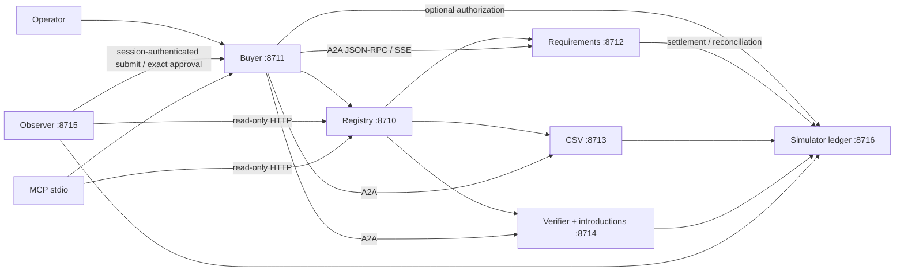

# Architecture

Agent Exchange separates discovering a provider, executing a task, paying for admission,
and deciding whether the result is useful. Each has its own state and evidence.

`exchange/processes.py` owns seven independent Python processes and a supervisor. It
checks ports, holds process locks and identifies children by PID, creation time and an
instance token in the command line. It never kills processes by broad name matching.
No service is installed as a system login item. Default binding is literal loopback.
A failed core service makes the supervisor stop the remaining owned services. The ledger
is optional: a ledger-only outage leaves free A2A collaboration running. Paid operations
retain their quote/order checkpoints and require reconciliation on recovery. Address-reuse
port probes allow immediate restart after closed connections, but refuse active listeners.

Each provider owns a SQLite task store. The buyer uses HTTP and does not read provider
or evaluator databases. WAL transactions and unique principal/idempotency-key constraints
prevent concurrent duplicate operations. Input changes require a new key, or an explicit
continuation of an input-required task with a new input version. A restart marks unfinished
provider workers failed; it does not silently repeat inference or execution.

The buyer persists the task/provider decision before dispatch. Model operations persist
trace/purpose/input hashes before launching a CLI. Completed outputs are reusable;
interrupted/failed calls require an explicit new run rather than an automatic inference
retry. Lost paid responses retain the original order, quote and authorization for
reconciliation. The single writer/service lock is part of the concurrency assumption.

The buyer queues bounded asynchronous submissions and resumes saved dispatch checkpoints
on restart. It queries immutable HTTP quotes from every eligible provider and stores
provider feedback from independently checked executions; policy refusals are excluded from
provider performance. Random selection uses a per-operation seed unless an explicit seed is
supplied. Requirement extraction overlaps all three provider instances; CSV and verification
remain additional specialist capabilities. Shared code is not independent implementation proof.

Dashboard sessions may submit tasks and explicitly approve simulated payment through a
separate operator client. The observer's ordinary peer credential remains read-only. An
approval preview binds the task, provider and quote by digest; agents cannot grant consent.
An atomic buyer outbox and persistent observer inbox/cursor retain `approval.requested` and
task notifications. This is the project-local Leo OS stub, not a connection to Leo OS.

Trace headers carry a trace ID and parent span across HTTP calls. Request spans connect
buyer dispatch, provider execution, ledger settlement and model events. Polling the observer
snapshot does not recursively generate its own snapshot events. The dashboard shows recorded
events and causal span links; model reasoning is not fabricated as progress.

Standard A2A subscription emits a snapshot followed by updates. Terminal subscriptions
are rejected; clients can query status. Cursor replay is a separately named application
extension. `ListTasks` uses principal-scoped, expiring database cursors and descending
status timestamps; concurrent task updates are not a historical snapshot guarantee.

Quotes are `leo.quote.v1` application objects. Negotiation is limited to three offers;
counteroffers supersede old terms and require new acceptance. Free dispatch never needs
the ledger. Optional `leo-sim-v1` payment charges once on admission, then polling and
artifact access remain free. Settlement, execution state and quality verdict are separate.

The independent buyer verifier checks source-derived evidence and CSV calculations; it
does not import provider service implementations. The offline evaluator owns hidden
synthetic distributions and passes only public candidate features and observed feedback
to the selector. This is architectural separation, not adversarial OS isolation.

MCP uses the installed official SDK over stdio. The local integration envelope has a
strict JSON Schema, an inbox, source/message deduplication, source-owned task mapping and
receiving cursors. Stub tests do not connect to Leo OS or Continuum. Their approved
endpoints and credentials remain prerequisites for actual integration.
