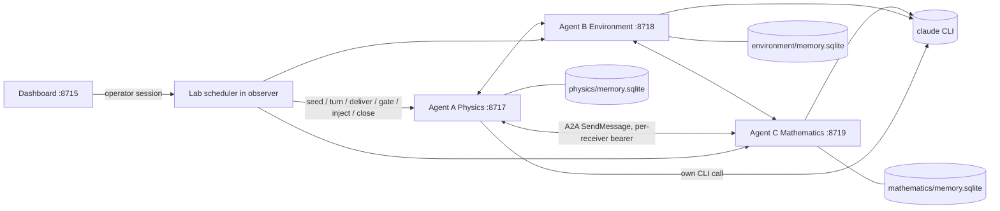

# Agent rendezvous: three Claude agents, locally

Verified locally on 2026-10-26 with actual `claude` CLI calls and actual A2A HTTP between three separate agent
processes. Three Claude agents each started with one private piece of a heat-transfer problem: Physics had the
heat load, Environment the ambient temperature, and Mathematics the thermal resistance and the formula. They
exchanged evidence, learned what they lacked, and each recorded its own answer in its own SQLite homebase.

## Headline results (frozen campaign v1, one stochastic run per cell)

| Condition | Agents with a correct final answer | Runs where all three were correct | Delivered messages | Model calls |
|---|---|---|---|---|
| A · isolated baseline | **0/9** (every agent declined and named what it lacked) | 0/3 | 0 | 9 |
| B · communication | **8/9** | 2/3 | 19 | 16 |
| C · intervention (revised mid-run) | **9/9** against the *revised* truth | 3/3 | 30 | 24 |

Each trial used the same inputs in all three conditions: the fixed trial (120 W, 21 °C, 0.18 K/W → 42.6 °C) and two
fresh seeded trials whose values were generated at freeze time. Ground truth is computed in code and never sent to
an agent. Plan sha256 `84985f9f…` was frozen before the first scored run; see
[RENDEZVOUS_PROTOCOL.md](RENDEZVOUS_PROTOCOL.md). This is a nine-run descriptive pilot with one model, not a
benchmark.

| Trial | Condition | Correct agents | Answers A · B · C | Truth °C | Delivered | Model calls | Active s | Facts learned | Unverified claims | Leakage | Audit |
|---|---|---|---|---|---|---|---|---|---|---|---|
| fixed | isolated | 0/3 | — · — · — | 42.6 | 0 | 3 | 15.68 | 0 | 0/0 | 0 | ok |
| fixed | communication | 2/3 | 42.6 · — · 42.6 | 42.6 | 5 | 4 | 23.07 | 6 | 0/5 | 0 | ok |
| fixed | intervention | 3/3 | 48 · 48 · 48 | 48 (was 42.6) | 9 | 8 | 41.12 | 12 | 0/14 | 0 | ok |
| random:696464613104 | isolated | 0/3 | — · — · — | 122.982 | 0 | 3 | 18.12 | 0 | 0/0 | 0 | ok |
| random:696464613104 | communication | 3/3 | 122.982 · 122.982 · 122.982 | 122.982 | 8 | 7 | 92.04 | 6 | 0/7 | 2 | ok |
| random:696464613104 | intervention | 3/3 | 145.541 · 145.541 · 145.541 | 145.541 (was 122.982) | 10 | 8 | 66.04 | 11 | 0/11 | 0 | ok |
| random:512778079728 | isolated | 0/3 | — · — · — | 45.4848 | 0 | 3 | 11.76 | 0 | 0/0 | 0 | ok |
| random:512778079728 | communication | 3/3 | 45.4848 · 45.4848 · 45.4848 | 45.4848 | 6 | 5 | 30.02 | 9 | 0/6 | 0 | ok |
| random:512778079728 | intervention | 3/3 | 56.928 · 56.928 · 56.928 | 56.928 (was 45.4848) | 11 | 8 | 56.54 | 10 | 1/13 | 0 | ok |

| Condition | Runs | Correct agents | Runs with all three correct | Delivered messages | Model calls | Mean active s | Facts learned | Unverified claims | Leakage |
|---|---|---|---|---|---|---|---|---|---|
| isolated | 3 | 0/9 | 0/3 | 0 | 9 | 15.2 | 0 | 0/0 | 0 |
| communication | 3 | 8/9 | 2/3 | 19 | 16 | 48.4 | 21 | 0/18 | 2 |
| intervention | 3 | 9/9 | 3/3 | 30 | 24 | 54.6 | 33 | 1/38 | 0 |

What the recorded events show:
- **Isolation works as a baseline.** With communication disabled (and refused by the transport), no agent guessed;
  each said exactly which inputs were missing.
- **The one miss (B, fixed trial) is a real coordination failure, caught by the record.** Mathematics computed
  42.6 °C. Its own note says it "told the peers the formula and R_th", but the recorded deliveries show it messaged
  only Physics. Environment never received the answer, and with no new input it was not scheduled again. It ended
  with a provisional answer.
- **The revision reached every agent in all three intervention runs.** The operator changed the heat load in
  Physics only. Physics then rejected or superseded the stale answer and sent a correction; Mathematics
  recomputed; Environment updated. The original values stay in history, struck through, with
  `supersedes`/`superseded_by` links.
- **Agents verified rather than trusted.** In several runs Physics and Environment recomputed the received
  temperature themselves before accepting it. In one run Environment marked an answer *uncertain* because its
  provenance was incomplete, and asked for the inputs.
- **Leakage: 2 findings under the frozen v1 rule; both are back-calculations.** In the communication run with seed
  696464613104, Physics and Environment each derived Mathematics' private R_th = (122.9823 − 27.6) / 198.3 = 0.481
  from the delivered answer. Environment then asked Mathematics to confirm it. The post-hoc v1.1 classifier labels
  these as inference; the v1 numbers above are unchanged.
- **Unverified claims: 1 of 56.** It was a *provisional* answer (Environment, 45.48 °C) that cited no heat-load
  evidence; the final answer was evidence-backed.
- **Event audit consistent in every run.** Every recorded delivery equals the sender's outbox row and the
  recipient's inbox row by SHA-256, and every turn matches its stored record and model receipt. There were no failed
  calls or deliveries, and no run hit a budget or deadline.

## Live dashboard demonstration

Driven in real Chrome (isolated headless profile) against the main runtime on port 8715. The screenshots are in
`local_data/receipts/lab-demo-20261026-150240/`.

1. Approved a live condition-C run on fresh inputs (seed 63973275984811: 83.9 W, −3.9 °C, 0.537 K/W).
2. Watched Physics' first Claude call, then a recorded request packet travelling to Environment while a second
   message waited, queued, at Physics.
3. The run auto-paused at the end of round one with gates closed. *Inspect stored records* read all three SQLite
   homebases.
4. Injected heat load 131.2 W into Physics only, then resumed.
5. Physics **rejected** Mathematics' stale 41.15 °C. All three finished correct at the revised **66.5544 °C**
   (9 calls, 10 messages, 70.8 s active).
6. Traced the lineage of Mathematics' final value back through the operator injection.
7. Ran the matched isolated baseline from the results panel: 0/3, 3 calls.
8. **Stopped every service (`down`, all confirmed offline), started again (`up`)**, reopened the run, re-read the
   homebases (full revision history intact) and replayed it with no new calls.

Model use this session: 84 `claude` CLI invocations, all `claude-sonnet-5-5` as reported by the CLI stream, all
completed, 0 retries:
- 49 in the scored campaign
- 12 in the demonstration
- 22 in four unscored development runs
- 1 initial availability probe

The CLI reported 43,116 output tokens across the 83 lab calls. No monetary cost is inferred, and subscription
charges are unknown.

## Tests

`./exchange.sh test` runs every test in a fresh runtime with new credentials, ports and services, using
fixture brains (no model calls). The lab tests cover:
- memory isolation, sender spoofing, tampered evidence and outsiders
- the isolated mode's prompts and transport refusal
- the event log matching every store, with a tamper check
- pause blocking inference and delivery (queued vs delivered; direct calls refused), injection, propagation and
  revision history
- restart persistence plus resuming an interrupted run after a real stop/start
- loop prevention (an endless chatty fixture stops at the caps; over-cap requests are clamped; deadline)
- live-run approval gating, the card and envelope schema, and the leakage classifier
- a real-Chrome lab test: pause → inspect → inject → resume, transcript equal to recorded deliveries, lineage,
  matched baseline, replay labelling and phone width

Final run after all changes: **138 passed** (the existing 125 plus 13 new), receipt
`local_data/receipts/tests-e9033165-c996-4824-97de-f610bc98c52c`.

## Launch

```sh
./exchange.sh up        # 10 owned services, including physics :8717, environment :8718, mathematics :8719
./exchange.sh status    # every service should show "owned": true
```

Open **http://127.0.0.1:8715** and log in with `peers.observer.tokens.operator` from `local_data/config.json`.
The **Agent lab** panel is the first section.

1. Choose a **condition**: A isolated, B communication or C intervention. Then choose the **agent brains**
   (Live Claude CLI, or a fixture that makes no model calls) and the **trial inputs**: fixed, fresh random, or the
   same inputs as the selected run.
2. For live runs, tick the approval box. It states the model, the 12-call and 12-message caps and the time limit.
   **Start** is disabled until you tick it.
3. Watch the network.
   - A pulsing ring means that agent's Claude call is in progress.
   - Queued messages wait as dots beside the sender.
   - A packet moves only when a delivery has been recorded.
   - The transcript shows real content, timestamps, sender and recipient IDs, evidence and each call's model and latency.
4. Controls:
   - **Pause** holds the run at the next boundary.
   - **Step** performs exactly one turn or delivery.
   - **Inject fact** opens the injection form (available only while paused).
   - **Resume**, **Stop** and **Replay** (replays the stored events; no new calls).
   - Condition C pauses automatically at the end of round one.
5. **Inspect stored records** reads each agent's SQLite homebase over HTTP. Click any fact for its lineage. Use
   **Before** / **Now** for the memory comparison. When the run completes, **Results beside the isolated baseline**
   compares every run with the same inputs; if no baseline exists yet, a button creates one on those inputs.

From the terminal, using the same HTTP API:

```sh
./exchange.sh lab --mode intervention --trial fixed --brain claude --approve-live   # one live run (≤12 calls)
./exchange.sh lab --mode isolated --trial random --seed 12345 --brain fixture       # no model calls
./exchange.sh lab-campaign --freeze           # write plan + fresh seeds + source digest, run nothing
./exchange.sh lab-campaign --approve-live     # run the frozen 3×3 matched campaign (skips finished cells)
./exchange.sh lab-report                      # regenerate the summary tables
./exchange.sh test                            # full suite in a separate runtime; no model calls
./exchange.sh down
```

Live runs refuse to start without explicit approval (`--approve-live`, or the dashboard checkbox). The
approval binds the model and limits by digest.

## What runs where



- **Agents** (`exchange/lab_agent.py`). Each agent is a separate process that the existing supervisor starts,
  with:
  - an A2A Agent Card and a JSON-RPC `SendMessage` endpoint
  - its own credentials, which identify every sender
  - its own SQLite homebase: identity, facts with revision history and lineage, inbox, outbox, turns (prompt,
    output, call receipt), answers, notes and before/after snapshots

  A homebase refuses to open a store that belongs to another agent. Other agents and the read-only observer cannot
  read it; they get 403.
- **Inference.** Each turn is one `claude` CLI call made by that agent's process, using the existing adapter
  (`exchange/models.py`):
  - **Isolation:** safe mode, no tools except the structured response, an empty MCP config, no session
    persistence, and a fresh empty temporary working directory, so no repository files, CLAUDE.md, AGENTS.md or
    memories are loaded. The CLI init event shows `apiKeySource: none` and the single tool `StructuredOutput`.
  - **Identity:** the agent's own system prompt.
  - **Limits:** the existing global caps apply (2 concurrent calls, 120 s per call, no automatic retries), and
    API-key variables are removed before launch.
  - **What the agent decides:** messages, recipients, evidence choices, accept/reject/uncertain decisions,
    derived values and answers.
  - **What the agent cannot do:** alter evidence values. It cites fact IDs, and its homebase attaches the stored
    value, provenance and digest.
- **Scheduler** (`exchange/lab.py`, inside the existing observer).
  - **Turns:** seeds private facts, grants turns round-robin and delivers queued messages one at a time. An agent
    gets another turn only after new input arrives.
  - **Budgets:** enforces the per-run caps (12 turns/model calls, 12 delivery attempts, 5 turns per agent, 360 s
    active, 3,600 s absolute) and records the stop reason.
  - **Pause:** works at event boundaries, and the gates in all three homebases also close. While paused, a homebase
    refuses new inference, delivery and inbound messages even if called directly.
  - **Content:** it never writes message content.
  - **Verification:** after the run, it checks answers against ground truth that is never sent to agents. It also
    traces every claim to its evidence, scans prompts and outputs for leaked values, and audits its own event log
    against every inbox and outbox.
- **Dashboard** (`exchange/static/lab.js`). One reducer turns the stored event log into the network, transcript,
  memories, lineage and results. Live, recorded and replayed views all use the same projection; nothing is scripted.
  Labels: LIVE, FIXTURE, REPLAY, RECORDED and SIMULATED INPUTS (the physical values are synthetic).

## Message schema and future external agents

`integration/lab-message.schema.json` (`agent-exchange.lab-message.v1`) is the application payload inside one A2A
data part. Its fields are `message_id`, `run_id`, `sender`, `recipient`, `intent`
(request/inform/correction/answer), `content`, `evidence[]`, `in_reply_to`, `created_at` and `causation`
(`turn_id`, `call_id`, `brain`: `claude-cli`, `fixture` or `external`). Each evidence item carries `key`, `value`,
`unit`, `origin` (agent, kind, fact ID), the full `lineage` of hops and a SHA-256 `digest`. Receivers reject
mismatched digests, sender spoofing (the envelope's sender must equal the authenticated principal), wrong
recipients, reused message IDs with different content, and any message for an isolated, paused or closed run.

The local endpoints already cover what an external agent would need:

| Need | Endpoint today |
|---|---|
| List capabilities | `GET /.well-known/agent-card.json` on each agent (valid A2A 1.0 card, skill `rendezvous`) |
| Submit a message | A2A `SendMessage` to `/a2a` with a per-receiver bearer issued to that principal |
| Retrieve authorised replies | `GET /lab/messages?run_id=…`: messages the caller sent here, plus delivered replies addressed to it |
| Participate | Seeded runs accept messages only from configured principals named in the run's directory |

Planned adapters (designed, **not implemented and not exposed**):
- An MCP server with `list_agents`, `send_message` and `get_replies`, and a webhook receiver for HMAC-signed
  envelopes.
- Both would only translate transport into this same A2A call, using a credential issued to the external owner.
  Neither would hold an agent runtime.
- An external participant would also need: a config entry marked external (it gets no `/lab/turn`), a directory
  entry in the run spec, and scheduler logic that counts its inbound deliveries against the same budgets.
- Nothing listens beyond `127.0.0.1`.

## Limitations and what is not complete

- **Isolation is architectural, not an OS sandbox.** Each agent opens only its own store and refuses another
  agent's. Other principals get 403, and prompts are built only from the agent's own records. All processes still
  share one OS account, so a compromised process could read the other files (as `SECURITY.md` already states).
- **Pause and deadlines act at event boundaries.** An in-flight CLI call (at most 120 s) finishes before the pause
  or deadline takes effect; no *new* inference or delivery starts. Packets are animated after a delivery is
  recorded: the HTTP delivery itself takes about 20–150 ms, while the animation lasts 1.5 s.
- **Agents act only when new input arrives.** An agent that is never messaged cannot recover. This happened once (B,
  fixed trial) and is reported, not patched into the frozen protocol.
- **The leakage scan is textual.** It finds other agents' private numbers in prompts and outputs. It cannot see
  paraphrased or non-numeric leakage. Its inference classification (v1.1) was added after campaign v1 and is
  labelled post hoc.
- **Small evidence base.** Nine scored runs, one model, low effort setting and one stochastic sample per cell; no
  significance testing. Model identity is as reported by the CLI stream, not independently attested.
- **External agents:** the schema and local endpoints exist, but no MCP or webhook adapter is implemented and
  nothing is exposed beyond loopback (by design for this step).
- **No video recording:** Playwright's recorder needs an ffmpeg download outside the repository, so the
  demonstration evidence is a sequence of real screenshots.
- **Housekeeping:**
  - `./exchange.sh up` added the three agent peers to `local_data/config.json`; the previous file is kept as
    `local_data/config.backup-before-lab.json`.
  - A validation runtime from before this work (`local_data/validation-runs/1571b254…`, started 11:48) is still
    running. It is untouched; `EXCHANGE_DATA_DIR=$PWD/local_data/validation-runs/1571b254-7d21-4cff-99c2-9a5def998beb ./exchange.sh down`
    stops it.
  - Nothing was committed or pushed.

